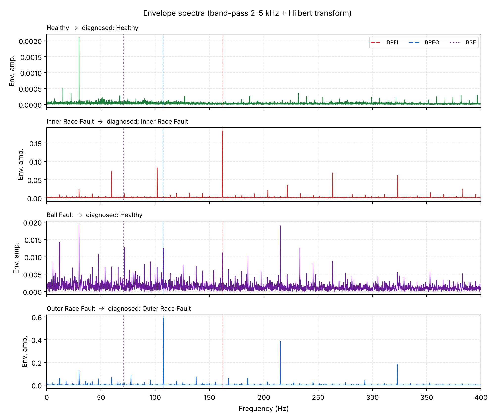

# Motor Bearing Fault Detection using FFT and Envelope Analysis (Python)

Course project for **21CSO352T – Python Programming**, B.Tech EEE, SRM Institute of Science and Technology.

This project detects rolling-element bearing faults in an induction motor using signal processing in Python. It uses the **Case Western Reserve University (CWRU) bearing dataset** (drive-end accelerometer, 12 kHz, ~1797 rpm, 0 hp load) and diagnoses each recording as **Healthy, Inner Race Fault, Outer Race Fault or Ball Fault** by matching spectral peaks to the bearing's characteristic fault frequencies.

The long-term motivation is **Motor Current Signature Analysis (MCSA)**: replacing a dedicated vibration sensor with a clamp-on current transformer. The CWRU data used here is vibration data, so this repository validates the signal-processing pipeline; moving it to stator-current data is listed as future work.

## Objectives

1. Load and inspect MATLAB `.mat` bearing recordings in Python.
2. Compare healthy and faulty signals in the time domain.
3. Convert signals to the frequency domain with the FFT and identify fault-related peaks.
4. Compute the bearing fault frequencies (BPFI, BPFO, BSF) from shaft speed.
5. Automate diagnosis using envelope analysis and peak detection.

## Repository structure

```
bearing_fault_fft_project/
├── data/                         CWRU recordings (included)
│   ├── 97.mat                    Healthy
│   ├── 105.mat                   Inner race fault, 0.007 in
│   ├── 118.mat                   Ball fault, 0.007 in
│   └── 130.mat                   Outer race fault (centred), 0.007 in
├── src/cwru_project/
│   ├── inspect_data.py           Step 1 – load files, list variables and shapes
│   └── step2_plot_time.py        Step 2 – time-domain plots (healthy vs inner race)
├── step3_fft.py                  Step 3 – FFT spectrum with BPFI marked
├── step4_fault_detection.py      Step 4 – features, envelope spectrum, automatic diagnosis
├── outputs/                      Saved figures, console outputs and results.csv
├── requirements.txt
└── pyproject.toml
```

## Requirements

- Python 3.8 or newer
- numpy, scipy, matplotlib

```bash
pip install -r requirements.txt
```

## How to run

Run every command from the repository root (the folder that contains `data/`):

```bash
python src/cwru_project/inspect_data.py      # Step 1: dataset structure
python src/cwru_project/step2_plot_time.py   # Step 2: saves outputs/fig1_time_domain.png
python step3_fft.py                          # Step 3: saves outputs/fig2_fft.png
python step4_fault_detection.py              # Step 4: diagnosis table + figs 3–5 + results.csv
```

Alternatively, install the package with `pip install .` and use the `cwru-inspect` and `cwru-plot-time` commands.

## Results

Bearing fault frequencies at 1796 rpm (SKF 6205-2RS JEM): **BPFI = 162.1 Hz, BPFO = 107.3 Hz, BSF = 70.5 Hz**.

| Recording | RMS (g) | Kurtosis | Envelope SNR at BPFI | at BPFO | at BSF | Diagnosis |
|---|---|---|---|---|---|---|
| Healthy | 0.074 | 2.77 | 7.6 | 4.7 | 4.7 | Healthy ✔ |
| Inner race | 0.291 | 5.40 | **244.3** | 5.9 | 17.2 | Inner Race Fault ✔ |
| Ball | 0.139 | 2.97 | 10.2 | 17.4 | 11.7 | Healthy ✘ |
| Outer race | 0.669 | 7.65 | 255.6 | **813.0** | 26.9 | Outer Race Fault ✔ |

**3 of 4 recordings are diagnosed correctly.** The ball fault is missed: its envelope spectrum shows no line clearly above the noise floor at BSF. This matches the CWRU benchmark study by Smith and Randall (2015), which found that many CWRU ball-fault recordings cannot be clearly diagnosed.



## Method in brief

- **FFT:** Hann-windowed, single-sided amplitude spectrum of whole-second segments (1 Hz resolution or finer).
- **Envelope analysis:** a 4th-order Butterworth band-pass (2–5 kHz) isolates the structural resonance excited by fault impacts; the Hilbert transform gives the envelope, whose spectrum shows the impact repetition rate.
- **Detection:** `scipy.signal.find_peaks` finds envelope lines more than 30× the spectral median; a fault is declared if a line lies within ±3 Hz of the fault frequency or its 2nd harmonic.

## Future work

- Apply the same pipeline to motor-current data (e.g. the Paderborn bearing dataset), looking for fault sidebands at f_supply ± k·f_fault.
- Acquire real current with a CT sensor and a microcontroller ADC for real-time monitoring.
- Add machine-learning classification and test across all loads and fault sizes.

## Dataset

Case Western Reserve University Bearing Data Center – https://engineering.case.edu/bearingdatacenter

## Author

Manjari Majumdar (RA2411005010075), III-year EEE, SRMIST
